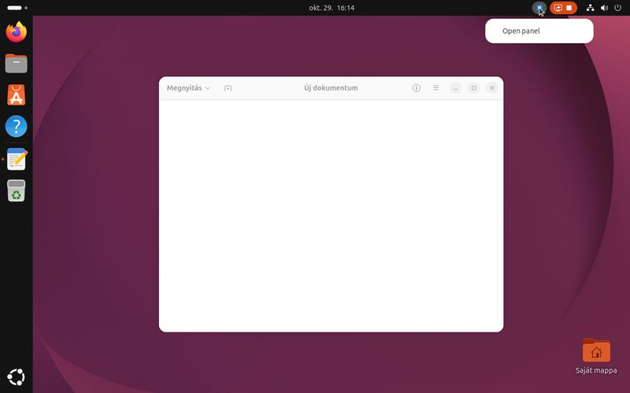
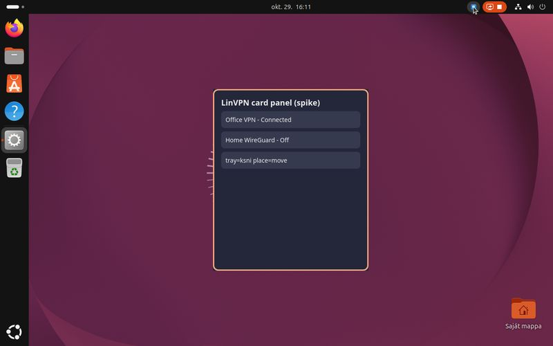
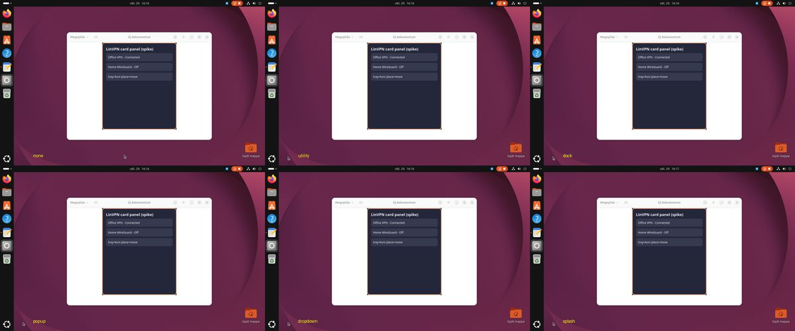
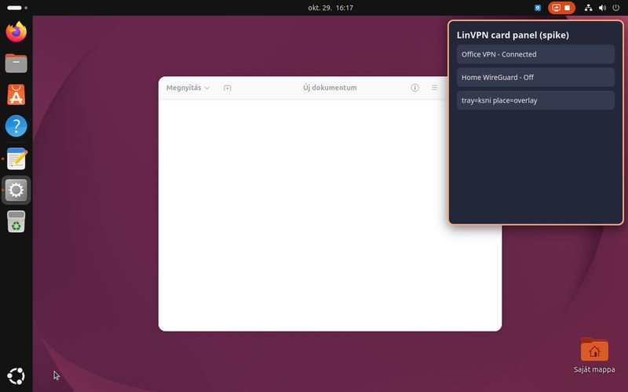
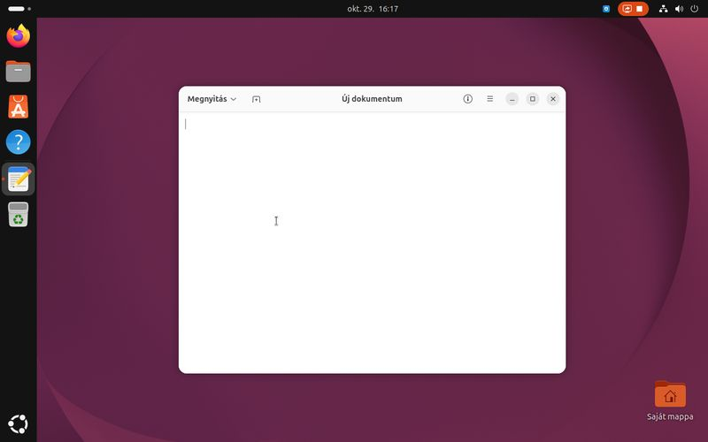
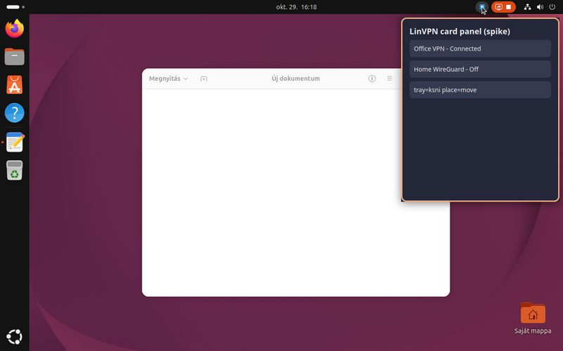

# Spike L0-2: LinVPN tray click → card panel near the top-right corner (Ubuntu GNOME, Wayland)

Question (spec [2026-10-29-linvpn-design.md](../specs/2026-10-29-linvpn-design.md), decision 4 and section 5, L0
spike 2): can a click on our tray icon open a custom window (the card panel) near the top-right corner, instead of the
indicator menu?

## Short answer

| Question | Result |
|---|---|
| (a) Tauri 2's tray (`tray-icon` 0.25.1 → libayatana-appindicator) delivers a click event? | **No.** Zero tray events on left, double, middle or right click. Its SNI has **no `Activate` method**, so the extension opens the menu on a left click. Without a menu the icon is **not shown at all**. Only menu item events arrive. |
| (b) Direct StatusNotifierItem (`ksni` 0.3.7): does a left click call `Activate(x, y)`? | **Only on a double click.** A single left click never calls `Activate` (the Ubuntu extension's code). Double click → `Activate(1096, 16)` = pointer position in shell stage coordinates (logical px, global). Middle click → `SecondaryActivate(x, y)`. Right click → the menu (nothing without a menu). Each call is preceded by `ProvideXdgActivationToken`. |
| (c) Can the panel be placed near the top-right on GNOME Wayland? | **Not with a positioned toplevel**: Mutter centres every Wayland toplevel in the work area, whatever `set_position`, keep-above or type hint. No layer-shell on GNOME. **Yes with a "transparent overlay" window** (maximized, transparent, input region = the card): the card sits exactly at the top-right under the top bar, clicks outside pass through. **Yes on Xwayland** (`GDK_BACKEND=x11`): exact position, and skip-taskbar works. |

**Recommendation:** ksni (zbus) StatusNotifierItem, *not* Tauri's tray, with a short menu whose first item opens the
panel (single left/right click → menu; double click and middle click → panel directly), and the card panel as a
**maximized transparent overlay window with an input region** on Wayland. Fallback: the panel as a plain
Xwayland (`GDK_BACKEND=x11`) window with an explicit position. Decision 4 holds; its fallback ("a short menu whose
first item opens the panel") is effectively the *main* path on Ubuntu GNOME, because a single left click cannot open
the panel there.

## Setup of this run

- VM: Ubuntu 26.04.1 desktop, kernel 7.0.0-42, **GNOME Shell 50.1** on Wayland (Xwayland running on `:0`), one
  virtual monitor 1280×800 at scale 1.0. Extension `ubuntu-appindicators@ubuntu.com` (system copy, shell-version
  45–50). GTK 3.24.52, WebKitGTK 4.1 2.52.6, libayatana-appindicator3 0.5.94.
- User: non-admin `linvpn-dev`, logged in on seat0; everything ran in that session from SSH. Nothing installed system
  wide, no sudo. Build: Rust 1.99.1, Tauri 2.12.5, tray-icon 0.25.1, ksni 0.3.7, gtk 0.18 (`Cargo.lock` committed).
- Spike code: `spikes/linvpn-tray/`
  - `tauri-panel/` — one Tauri 2 app, switches by environment: `TRAY=tauri|ksni`, `MENU=0|1`,
    `PLACE=none|move|overlay`, `HINT=none|utility|dock|popup|dropdown|splash`, `TOKEN=0|1`, `SHOW_AT_START`,
    `HIDE_ON_BLUR`. Every tray and window event is logged to stderr with a millisecond timestamp.
  - `tools/drive.py` — pointer/keyboard input and screenshots in the Wayland session through **Mutter's own
    `org.gnome.Mutter.RemoteDesktop` + `ScreenCast` D-Bus API** (no portal, no dialog) and `gst-launch-1.0
    pipewiresrc` for frames. While it runs, GNOME shows the orange screen-sharing pill in the top bar (visible in the
    screenshots); it is not part of LinVPN.
  - `tools/run.sh` — starts the spike in the desktop session (`XDG_RUNTIME_DIR`, session bus, `WAYLAND_DISPLAY`,
    `DISPLAY=:0`, and Xwayland's `XAUTHORITY`, which an SSH shell does not inherit).
- **The dialog the maintainer approved**: my first screenshot attempt used the xdg-desktop-portal Screenshot API
  (`interactive=false`). GNOME showed a permission dialog for it ("connection attempt" / allow screenshot), the call
  timed out, and the maintainer approved it later; the permission store now has a `screenshot` entry for the host
  app id `""`. Nothing else needed approval; the portal helper was dropped and all screenshots came from Mutter's
  ScreenCast. If unwanted, the grant can be removed with
  `gdbus call --session -d org.freedesktop.impl.portal.PermissionStore -o /org/freedesktop/impl/portal/PermissionStore -m org.freedesktop.impl.portal.PermissionStore.DeletePermission screenshot screenshot ''`.

## (a) Tauri 2 tray (tray-icon → libayatana-appindicator)

The SNI object libayatana registers (introspected on the bus, `/org/ayatana/NotificationItem/tray_icon_tray_app_spike`):

```
methods: Scroll(i, s)  SecondaryActivate(i, i)  XAyatanaSecondaryActivate(u)
         -- no Activate, no ContextMenu
Menu = '/org/ayatana/NotificationItem/tray_icon_tray_app_spike/Menu'
```

| Action | Result (log + screenshot) |
|---|---|
| `MENU=0` (no menu) | **No icon in the top bar**; the item is not even in the watcher's `RegisteredStatusNotifierItems`. libayatana needs a menu. |
| `MENU=1`, single left click | The menu opens at once (`a-tauri-left-click-menu.jpg`). **No `on_tray_icon_event`.** |
| double left click | Menu opens and closes again. No event. |
| middle click | Nothing visible, no event (the shell calls `XAyatanaSecondaryActivate`; tray-icon does not use it). |
| menu item "Open panel" | `tauri tray: menu event MenuId("open")` → panel shown and focused. No activation token, no coordinates. |

So with Tauri's built-in tray the only route to the panel on Linux is a menu item. tray-icon's own docs list tray
click events as unsupported on Linux; this matches.



## (b) Direct StatusNotifierItem with ksni

ksni registers `org.kde.StatusNotifierItem-<pid>-1` with `Activate`, `SecondaryActivate`, `Scroll`,
`ProvideXdgActivationToken`, `ItemIsMenu=false` (`MENU_ON_ACTIVATE=false`).

What the Ubuntu extension does (its source, `indicatorStatusIcon.js` `vfunc_button_press_event` and
`_maybeHandleDoubleClick`, confirmed by the runs below):

- **left button:** counts clicks with Clutter's double-click time (400 ms, `org.gnome.desktop.peripherals.mouse
  double-click`). A **double click** calls `Activate`. A single click only toggles the menu, after waiting the
  double-click time, and only if the menu has items. `Activate` is never called on a single click.
- **middle button:** `XAyatanaSecondaryActivate(timestamp)` if the item has it, else `SecondaryActivate(x, y)`.
- **right button:** toggles the menu.
- **before Activate/SecondaryActivate:** `ProvideXdgActivationToken(token)` (KDE extension). If the item answers
  `Activate` with `UnknownMethod` (what ksni does for `ItemIsMenu=true`), the extension treats it as menu-only and opens
  the menu immediately on a left click.

Observed, `MENU=0` (empty menu):

```
single left click     -> (nothing; no D-Bus call, no menu)
double left click     -> [ 72782] ksni: Activate(x=1096, y=16) token=Some("gnome-shell/LinVPN spike/44993-0-tesztlinux_TIME1282828")
                         [ 72824] window panel: Focused(true)          (42 ms after Activate)
middle click          -> [ 99948] ksni: SecondaryActivate(x=1096, y=16) token=Some(...)
right click           -> (nothing)
```

Observed, `MENU=1` (one item "Open panel"), `dbus-monitor` of the shell's calls:

```
single left click  -> com.canonical.dbusmenu.Event(0, "opened"), AboutToShow(0)   -> menu shown (b-ksni-menu-single-click.jpg)
menu item          -> ksni: menu item 'Open panel' token=Some("gnome-shell/...")  -> panel shown, focused
double left click  -> ProvideXdgActivationToken("gnome-shell/LinVPN spike/44993-14-..."), Activate(1096, 16)  (no menu flash)
middle click       -> ProvideXdgActivationToken(...), SecondaryActivate(1096, 16)
```

**Coordinates:** `(1096, 16)` is the pointer position at the click in the shell's stage (global logical pixels): the
icon sat at x ≈ 1086–1106 in the 32 px top bar. They are usable to centre the card under the icon (in overlay or
X11 mode); on Wayland a positioned toplevel ignores them anyway.

**Focus:** the panel got keyboard focus every time (`Focused(true)` 30–50 ms after `Activate`), also when another
app (gnome-text-editor) had focus before, and also with `TOKEN=0` (token not used). The token is still worth passing
(`gtk_window_set_startup_id`), since Mutter's focus-stealing rules may be stricter elsewhere.

**Toggle:** clicking the top-bar icon does not take focus from the panel (no `Focused(false)`), so a second double
click on the icon reaches `Activate` while the panel is visible and can close it (`toggle: hide`). Focus loss
(click elsewhere, Super/overview) closed it via `Focused(false)`.



## (c) Window placement under GNOME Wayland

### Layer shell

Mutter's Wayland globals (from `WAYLAND_DEBUG=1`): `xdg_wm_base v7`, `xdg_activation_v1`, `gtk_shell1 v7`,
`xdg_wm_dialog_v1`, `xdg_toplevel_tag_manager_v1`, `zxdg_exporter/importer v1+v2`, … — **no `zwlr_layer_shell_v1`**
(and no other positioning protocol). gtk-layer-shell cannot work on GNOME. GTK popups (`xdg_popup`) need a parent
surface of our own, so they cannot hang off the shell's top bar either.

### Undecorated, always-on-top, explicit position, type hints

`PLACE=move`: `set_position(912, 8|40)` + `gtk_window_move`, decorations off, `always_on_top`, `skip_taskbar`, plus
each GDK type hint `none, utility, dock, popup, dropdown, splash`. In **every** case Mutter put the 360×420 window at
the **centre of the work area** (x 493–853, y 207–627 = centre of 67…1280 × 32…800). GTK reports position `(0, 0)`
and `Moved(0, 0)`; GDK's work area is unknown on Wayland (`top 0`). `skip_taskbar` has no effect on Wayland: the
panel shows up as an extra (generic gear) icon in the Ubuntu dock while open.



### Transparent overlay with an input region (works on Wayland)

`PLACE=overlay`: the panel window is undecorated, `transparent(true)`, **maximized** (so Mutter fills the work area:
1213×768 at (67, 32) here); the page draws the card at `top: 8px; right: 8px` on a transparent background, and the
GDK window's **input region** is set to just the card rectangle (`gdk_window_input_shape_combine_region`, i.e.
`wl_surface.set_input_region`).

- The card appears exactly at the top-right, 8 px under the top bar, next to the tray icon.
- A click outside the card passes through to the window underneath (gnome-text-editor took focus and the I-beam
  cursor shows over it) → the panel gets `Focused(false)` → hides.
- A click inside the card keeps it open.
- Opening via double click, three open/close cycles, toggle from the icon, and Super (overview) all behaved.
- **Pitfall found:** GtkWindow resets the input shape on every size-allocate (its CSD shape update). The first
  version set the region only after `show`; after a later show the whole transparent window swallowed clicks. Fix:
  re-apply the region from a `size-allocate` handler (`connect_size_allocate`, runs after GTK's own). With that, it
  held in all runs.




Costs and open points of the overlay:
- While open it is a real (maximized) toplevel: it appears in the dock and Alt+Tab (both close it at once through
  focus loss). Use the app's own `.desktop`/app id so the dock shows the LinVPN icon, not a generic one.
- Multi-monitor and fractional scaling were not testable (one virtual monitor, scale 1). Mutter maximizes on the
  monitor it places the window on (normally the one with the pointer/focus); the card should go to the right edge
  of *that* window, which is what the CSS does.
- The window covers the work area only (not the top bar), so the card cannot overlap the bar; that is the desired look.

### Xwayland backend (`GDK_BACKEND=x11`)

`PLACE=move` under Xwayland: `Moved(912, 40)`, `outer_position (912, 40)`, GDK work area top 32 (known on X11) — the
card sits exactly top-right under the bar; focus `true` 7 ms after `Activate`; focus loss hides; **skip_taskbar
works** (no dock icon). The ksni tray is independent of the GDK backend.



What it costs:
- The whole Tauri process runs on X11 (tao/WebKitGTK use the default display), so the main window loses Wayland too:
  blurry under fractional scaling (Xwayland scales X11 clients unless Mutter's experimental Xwayland native scaling
  is on), X11 input/IME path, X11's weaker client isolation.
- Needs Xwayland (GNOME 50 still starts it on demand) and `DISPLAY`/`XAUTHORITY` in the environment (autostart and the
  `.desktop` launch have them; an SSH shell does not).
- Speed: the panel had focus 7 ms after `Activate` on X11 vs 30–50 ms on Wayland; both feel instant. Memory was
  measured only on X11 (spike debug build ~177 MB RSS + ~250 MB WebKit processes), not compared.

## Recommended design for LinVPN on Ubuntu GNOME (Wayland)

1. **Tray = our own StatusNotifierItem via `ksni`** (zbus, same stack as the NM client), not Tauri's `tray-icon` on
   Linux. `ItemIsMenu=false`, implement `Activate`, `SecondaryActivate`, `ProvideXdgActivationToken`
   (ksni does), status icons via `IconPixmap` or a theme path.
2. **Menu (dbusmenu), short:** first item **"Open LinVPN"** (opens the card panel), then the status line(s) if wanted,
   then Quit. On GNOME: single left click (after the 400 ms double-click wait) or right click → this menu.
3. **Direct open:** `Activate` (double click on GNOME; single click on KDE and others that follow the spec) and
   `SecondaryActivate` (middle click) → toggle the panel. Pass the activation token to GTK
   (`gtk_window_set_startup_id`) before presenting.
4. **Panel window on Wayland = transparent maximized overlay with an input region** = the card rectangle, re-applied
   on every size-allocate; hide on focus loss; the card is drawn top-right by CSS (optionally under the clicked
   icon's x from `Activate`).
5. **Fallback** (if the overlay misbehaves on real hardware, multi-monitor or fractional scaling): run the panel on
   Xwayland with an explicit position (`GDK_BACKEND=x11` for the app), accepting the X11 costs above. Last resort:
   a normal Wayland window, which Mutter centres.

Rejected: Tauri `tray-icon` (no events), gtk-layer-shell (no protocol on GNOME), opening the panel from dbusmenu
`AboutToShow` (the shell's menu would still open over it and take the grab), a LinVPN GNOME Shell extension (could
give single click + exact placement, but per-shell-version maintenance and the user must enable it; possible later).

## For the maintainer to check on the screen

The VM still has the built spike (`~/spike/linvpn-tray/tauri-panel/target/debug/linvpn-tray-spike`) and
`~/spike/run.sh`. No process of it is running.

1. Start the recommended variant from a terminal *in the desktop session* (or SSH + `sh ~/spike/run.sh check
   TRAY=ksni MENU=1 PLACE=overlay`): `TRAY=ksni MENU=1 PLACE=overlay ~/spike/linvpn-tray/tauri-panel/target/debug/linvpn-tray-spike`.
2. With the real mouse, check:
   - **double click** on the blue LinVPN icon in the top bar: the card appears top-right **without a visible flash**
     (black/white full-screen frame or a maximize animation) — the screenshots cannot show transient frames;
   - **single click**: the "Open panel" menu appears after a short delay (≈0.4 s) — is that delay acceptable?
   - click outside the card: it disappears, and the click lands on what is underneath;
   - while open, the dock shows an extra icon (generic gear in the spike) — acceptable?
3. Optional, Xwayland look: same with `GDK_BACKEND=x11 TRAY=ksni MENU=1 PLACE=move`; at 125 % scaling (Settings →
   Displays, fractional scaling on) check whether the card text is blurry.
4. Stop: `pkill -x linvpn-tray-spi`.
